<div align="center">

# 🪐 SENDA — *Safe Paths to Martian Science*
### **NASA Space Apps Challenge 2026 · Interplanetary Survival Guide: Martian Map**
**Human EVA Traverse Planning, 3D Topographic Digital Twin & Real-Time Life-Support Telemetry for the Gale Crater — Mount Sharp Boxwork Unit ($4.785^\circ\text{S}–4.810^\circ\text{S},\; 137.375^\circ\text{E}–137.400^\circ\text{E}$)**

[](https://senda-mars-nasa-2026.netlify.app)
[-4FC3F7?style=for-the-badge)](https://hirise.lpl.arizona.edu/)
[](https://mars.nasa.gov/msl/)
[](#data-provenance--scientific-integrity)

</div>

---

## 🌐 Live Interactive Web Application
👉 **Launch SENDA Mission Control:** **[https://senda-mars-nasa-2026.netlify.app](https://senda-mars-nasa-2026.netlify.app)**
- **Zero-Install Portable Single-File Edition:** Open [`SENDA_Mars_NASA_Portable.html`](./SENDA_Mars_NASA_Portable.html) directly in any browser (100% offline capable).
- **Guided 6-Stage NASA Jury Tour:** Click **`🎬 DEMO`** in the top bar for an automated, voice-narrated walkthrough (`CAPCOM` + authentic Apollo/ISS Quindar telemetry tones at $2525\text{ Hz}$ / $2475\text{ Hz}$).

---

## 🔬 1. Executive Summary & Central Scientific Question

Between **Sols 4418 and 4711**, the **MSL Curiosity rover** ascended into the **Mount Sharp Boxwork Unit** in Gale Crater—an enigmatic kilometer-scale polygonal network of mineral-cemented ridges rising $2\text{ to } 5\text{ m}$ above wind-scoured mudstone hollows.

**SENDA (*Safe paths to Martian science*)** is a dual-crew human Extravehicular Activity (EVA) planning and real-time field telemetry platform designed to answer the central planetary geology question of the Boxwork unit:

> **Why do the polygonal Boxwork ridges resist eolian erosion while adjacent hollows excavate?**
> By routing astronauts `EV-1` (Geologist) and `EV-2` (Commander) from **Rustic Canyon Base (`T01`, $-3734.7\text{ m}$)** to the **Paired Summit Drill Sites `T05` (*Valle de la Luna* Hollow) and `T06` (*Nevado Sajama* Ridge) located just $10.4\text{ m}$ apart at $-3608\text{ m}$**, SENDA enables a controlled paired rotary core experiment ($10\text{ cm}$ depth) comparing unaltered lacustrine *Murray* mudstone ($14.5\text{ MPa}$ UCS) against $\text{CaSO}_4\cdot 0.5\text{H}_2\text{O}$ bassanite-cemented fracture conduits ($48.0\text{ MPa}$ UCS)—while keeping the crew within **NASA-STD-3001** oxygen, $\text{CO}_2$, thermal, and Solar Particle Event (SPE) radiation limits.

---

## 🧭 2. System Architecture

```mermaid
flowchart LR
  subgraph ORBITAL["🛰️ Measured NASA Orbital & Rover Datasets"]
    DEM["USGS HiRISE DEM (1.0 m/px)\nDTEEC_063842_1750_063908_1750_U01"]
    ORTHO["HiRISE RED Orthomosaic\n(0.25 m/px)"]
    CRISM["MRO CRISM VNIR/IR\nFe/Mg Smectites & Sulfates (18 m/px)"]
    MSL["MSL Curiosity Telemetry\nREMS · RAD · APXS · ChemCam · CheMin"]
  end

  subgraph ENGINE["⚙️ SENDA Physics & Pathfinding Core"]
    HORN["Horn 3×3 Slope & TRI\n(>20° Impassable Mask)"]
    ASTAR["8-Neighbor Anisotropic A*\n(Validated A* == Dijkstra, 0.00% Gap)"]
    PANDOLF["Pandolf (1977) 0.38g EVA Model\nO₂ · LiOH CO₂ · LCVG H₂O · Asymmetric Load"]
    SHIELD["360° Horizon Sky-View\nTopographic Radiation Shielding"]
  end

  subgraph UI["🖥️ Interactive Mission Control (2D GIS + 3D DEM + Labs)"]
    MAP2D["2D Cartographic GIS\n+ 50m T05/T06 Summit Inset"]
    DEM3D["5,000-Triangle 3D DEM Engine\nLambertian Sun + Visor POV + Drone LiDAR"]
    LABS["Planetary Science & EVA Labs\nDrill LIBS · GPR · SHERLOC · xEMU Bio-Twin · Pareto · Monte Carlo"]
  end

  ORBITAL --> ENGINE --> UI
```



---

## 🏛️ 3. Key Engineering & Planetary Science Modules

### 🗺️ A. Multi-Mission 2D GIS & Synchronized 2D+3D Split View (`PLAN`, `FIELD`, `3D DEM`, `🌓 SPLIT`)
- **8 Toggleable Cartographic Layers:**
  1. **HiRISE Orthomosaic (`0.25 m/px`)** — `MEASURED`
  2. **MOLA + HiRISE Shaded Relief (`1.0 m/px`)** — `MEASURED`
  3. **Slope Classification (`<10° Safe`, `10°–20° Caution`, `>20° Impassable`)** — `MODELED`
  4. **Composite Traverse Risk Index (`0–1`)** — `MODELED`
  5. **MRO CRISM Sulfate & Clay Spectral Index (`SINDEX2 / BD1900`)** — `MEASURED`
  6. **Topographic Radiation Shielding (`% Dose Reduction` from $360^\circ$ horizon mask)** — `MODELED`
  7. **RF Comms Line-of-Sight (`T01` $4.5\text{ m}$ S-Band Mast vs. `MRO / TGO` Electra UHF Relay)** — `MODELED`
  8. **8 Curiosity Science Targets (`T01–T08`) & 3 Pareto EVA Routes** — `MEASURED / MODELED`
- **`🔍 50m Summit Micro-Inset Loupe`:** Magnifies the $10.4\text{ m}$ separation between **`T05` (Hollow)**, **`T06` (Ridge)**, and **`T08` (Radiation Shelter)** on the 2D map.
- **Live Interactive A\* Pathfinder & Obstacle Painter:** Click **`📍 Click A* Route`** anywhere on the terrain or paint custom boulder/slope hazards (**`🚧 Paint Hazard`**) to watch the 8-neighbor $A^*$ solver reroute in $<5\text{ ms}$.

### 🏔️ B. Photorealistic 3D DEM Engine, Helmet Visor HUD & Autonomous Hexacopter Drone (`CHOPPER-1`)
- **Depth-Sorted 5,000-Triangle 3D Terrain Block:** Features real-time Lambertian solar hillshading ($\vec{N}\cdot\vec{L}$), geological cutaway walls exposing *Murray* mudstone and subsurface $\text{CaSO}_4$ veins, and vertical exaggeration (`1×`, `2.5×`, `4×`, `6×`).
- **5 Interactive 3D Camera Modes:**
  - `🛰️ Orbit 3D` — Full orbital inspection with orbiting `MRO / TGO` relay satellite and RF laser links.
  - `🎥 Follow Crew` — Dynamic chase camera tracking `EV-1` and `EV-2`.
  - `👨‍🚀 Helmet Visor` — First-person pressurized `xEMU` helmet HUD with artificial horizon, heading tape, holographic target pins, and authentic **Martian Rayleigh/Mie Blue Sunset** at `17:52 LTST`.
  - `🚁 Drone LiDAR` — Aerial $0.05\text{ m/px}$ green point-cloud camera from the **`CHOPPER-1` (*Ingenuity II* Hexacopter)** flying $22\text{ m}$ high and $120\text{ m}$ ahead of the crew to detect sub-meter boulders ($<2\text{ m}$) invisible in the $1\text{ m}$ HiRISE DEM.
  - `🔬 T05/T06 Ridge` — Precision close-up on the paired Boxwork summit targets.

### 🧪 C. Categorized NASA Science & Engineering Laboratories (`🧪 NASA LABS & TOOLS ▾`)
| Category | Module | Scientific / Operational Capability |
| :--- | :--- | :--- |
| **1. Planetary Geology & Astrobiology** | **🔬 Drill Core & ChemCam LIBS Laser Zapper** | Interactive $10\text{ cm}$ rotary drill core with 3 clickable UV/LIBS pulsed laser micro-targets (`#1 White CaSO₄ Vein`, `#2 Fe/Mg Ridge Halo`, `#3 Hollow Mudstone Matrix`), plasma snap audio, and $240–850\text{ nm}$ atomic emission spectra. |
| | **📡 RIMFAX Subsurface GPR Radargram** | $150–1200\text{ MHz}$ Ground-Penetrating Radar profile ($0–15\text{ m}$ depth) revealing hyperbolic diffraction roots of Boxwork conduits down to $-11.6\text{ m}$ and the basal *Murray* contact ($-10.2\text{ m}$). |
| | **🧬 SHERLOC Deep-UV Raman & SAM GC-MS Lab** | Compares Galactic Cosmic Ray (GCR) radiolytic degradation in exposed `T05` hollows ($29\%$ organic survival at $8\text{ cm}$) against $\text{CaSO}_4$-encapsulated `T06` veins ($84\%$ preservation of aromatic G/D bands and thiophenes $\text{C}_4\text{H}_4\text{S}$). |
| | **⚖ T05 vs. T06 Paired Hypothesis Comparator** | Side-by-side geochemical (`APXS` $\text{wt}\%$), mechanical (`UCS MPa`), and mineralogical (`CheMin XRD`) differential analysis. |
| **2. EVA Life Support & Optimization** | **🫀 xEMU Spacesuit Digital Twin & Live ECG** | Dual-astronaut (`EV-1` & `EV-2`) telemetry with live Lead-II P-Q-R-S-T ECG waveform, suit pressure ($29.6\text{ kPa}$), LCVG sublimator cooling water ($4.2\text{ L}$), $\text{LiOH}$ $\text{CO}_2$ canister saturation ($850\text{ g}$), and **NASA-STD-3001** organ dosimetry (*Skin*, *Eye Lens*, *BFO*). |
| | **📈 Multi-Objective Pareto Frontier Optimizer** | Interactive sliders for $\alpha\text{ (Science)}$, $\beta\text{ (Metabolic O}_2)$, and $\gamma\text{ (Slope Safety)}$ with real-time Pareto curve synthesis. |
| | **🎲 1,000-Run Monte Carlo Survival Analyzer** | Box-Muller stochastic simulation across $\pm 20\%$ Pandolf metabolic and regolith sinkage uncertainty, plotting $P_{10}/P_{50}/P_{90}$ fan charts against the Bingo $\text{O}_2$ walkback floor. |
| | **🧪 MSR Titanium Tube Rack & Knapsack Triage** | Tracks all 8 Cat-IVb hermetic titanium tubes ($4.6\text{ kg}$ total) with a 0/1 Knapsack emergency advisor that drops secondary tubes to save $+11.4\text{ L O}_2$ while preserving 100% of the `T05/T06` paired cores. |
| **3. Flight Data & GIS Exports** | **📋 Printable NASA EVA Wrist Cuff Checklist** | Generates the astronaut cuff timeline with cumulative elapsed minutes, sampling tools, and **Bingo $\text{O}_2$** walkback triggers. |
| | **📄 Official NASA Executive Mission Report** | Printable JPL/JSC mission dossier (`DOC-ID: JSC-JPL-SENDA-5074`). |
| | **💾 Standard `.GeoJSON` GIS Exporter** | One-click download of `SENDA_Gale_Boxwork_Mission_Sol5074.geojson` (`IAU2015:49900`) for **QGIS**, **JMARS**, and **Google Earth Pro (Mars)**. |

---

## 📐 4. Mathematical & Physical Models

1. **Topographic Slope (Horn $3\times 3$ Finite Difference):**
   $$\theta = \arctan\left(\sqrt{\left(\frac{\partial z}{\partial x}\right)^2 + \left(\frac{\partial z}{\partial y}\right)^2}\right) \cdot \frac{180^\circ}{\pi}$$
   Cells with $\theta > 20^\circ$ are masked as impassable (`NO-GO`) for pressurized `xEMU` foot traverses.

2. **Anisotropic 8-Neighbor $A^*$ Cost Function & Optimality Guarantee:**
   $$J(i \to j) = \alpha \cdot \Delta E_{\text{Pandolf}}(i \to j) + \beta \cdot \Delta t(i \to j) + \gamma \cdot R_{\text{risk}}(j) - \delta \cdot S_{\text{science}}(j)$$
   Verified via unit test against **Dijkstra's algorithm** ($0.00\%$ optimality gap using an admissible Euclidean lower-bound heuristic).

3. **Martian-Adapted Pandolf (1977) Metabolic Power & Consumables ($g_{\text{Mars}} = 3.721\text{ m/s}^2 \approx 0.38\,g_{\oplus}$):**
   $$M_{\text{Mars}} = \gamma_{\text{suit}} \left[ 1.5 W + 2.0 (W + L)\left(\frac{L}{W}\right)^2 + \eta_{\text{sink}} (W + L_{\text{eff}})\left(1.5 V^2 + 0.35 V \cdot G\right) \right]$$
   where $\gamma_{\text{suit}} = 1.25$, $L_{\text{eff}} = 0.38(L_{\text{PLSS}} + m_{\text{samples}})$, and $\dot{V}_{\text{O}_2} = \frac{M_{\text{Mars}} \cdot 60}{20,100\text{ J/L}}$ ($\pm 20\%$ uncertainty band).

4. **Point of No Return (Safe Walkback Envelope):**
   $$\text{O}_{2,\text{rem}}(t) \ge 1.30 \times \text{O}_{2,\text{return}}(x(t) \to \text{T01})$$

---

## 🛡️ 5. Data Provenance & Scientific Integrity (`MEASURED` · `MODELED` · `ASSUMED`)

Every number in SENDA carries an explicit provenance chip so astronauts and mission controllers never confuse orbital measurements with model projections:

| Badge | Category | Datasets & Variables |
| :---: | :--- | :--- |
| **`MEASURED`** | **Empirical NASA Flight Data** | • **USGS / UArizona HiRISE PDS4 DEM** (`DTEEC_063842_1750_063908_1750_U01`, $1.0\text{ m/px}$) & RED Orthomosaic ($0.25\text{ m/px}$)<br>• **MRO CRISM** polyhydrated sulfate & smectite spectral parameters ($18\text{ m/px}$)<br>• **MSL Curiosity Waypoints** (Sols 4418–4711), **REMS** diurnal thermal cycle ($-13\,^\circ\text{C}$ to $-79\,^\circ\text{C}$, $745\text{ Pa}$), and **RAD** surface radiation ($0.64\text{ mSv/sol}$ GCR baseline) |
| **`MODELED`** | **Physics-Based Derivations** | • Horn $3\times 3$ slope & Terrain Ruggedness Index (TRI)<br>• $A^*$ / Dijkstra optimal paths (`Safe`, `Balanced`, `Scientific`)<br>• Pandolf $0.38g$ metabolic $\text{O}_2$, $\text{LiOH}$ $\text{CO}_2$, and LCVG $\text{H}_2\text{O}$ consumption<br>• Bekker-Wong LTV Rover terramechanics (wheel slip % & $\text{Li-S}$ battery $\text{kWh}$)<br>• $360^\circ$ horizon sky-view radiation shielding ($-38\%$ at `T08` escarpment) |
| **`ASSUMED`** | **NASA Reference Parameters** | • `xEMU` PLSS usable oxygen capacity ($300\text{ L}$ at $29.6\text{ kPa}$)<br>• Maximum astronaut slope limit ($20^\circ$) and $\times 1.3$ emergency walkback reserve<br>• Contingency multipliers (SPE proton flux, $\tau = 3.5$ dust storm, $\times 1.5$ suit leak, $\times 0.5$ injury buddy walkback) |

---

## ⌨️ 6. Mission Control Keyboard Shortcuts

| Key | Action |
| :---: | :--- |
| **`Space`** | Play / Pause Live EVA Traverse Simulation |
| **`1` / `2` / `3`** | Switch between `PLAN` (2D GIS), `FIELD` (Live Telemetry), and `3D DEM` |
| **`S`** | Toggle Synchronized `2D GIS + 3D DEM` Dual-Screen Split View |
| **`F`** | Toggle Fullscreen JPL Theatre Mode |
| **`Esc`** | Close active laboratory modal or dropdown menu |

---

## 🚀 7. Quick Start (Local Execution)

### Option 1 — Instant Browser Launch (Zero Dependencies)
Simply double-click [`index.html`](./index.html) or [`SENDA_Mars_NASA_Portable.html`](./SENDA_Mars_NASA_Portable.html), or open with VS Code **Live Server (Go Live)**.

### Option 2 — Local Development Server
```bash
cd senda-mars
npx serve .
```

### Option 3 — Offline Python DEM & Physics Pipeline
```bash
cd senda-mars
python scripts/process_dem.py
```

---

## 👨‍🚀 8. Official Mission Team — SENDA (NASA Space Apps Challenge 2026)

| # | Team Member | Official Email |
| :---: | :--- | :--- |
| **1** | **Jhon Alex Centeno** | `alexpiper616@gmail.com` |
| **2** | **Jose Elias Cabeza** | `jose.cabeza@utec.edu.pe` |
| **3** | **Esau Arqueros** | `esau.arqueros.24@gmail.com` |
| **4** | **Anderson Morales Durand** | `moralesdurandanderson@gmail.com` |
| **5** | **Mathias** | `mathigza@gmail.com` |

---

<div align="center">
  <strong>Developed for the NASA Space Apps Challenge 2026</strong><br>
  <em>"Safe paths to Martian science — From orbital pixels to human footsteps on Mount Sharp."</em>
</div>
